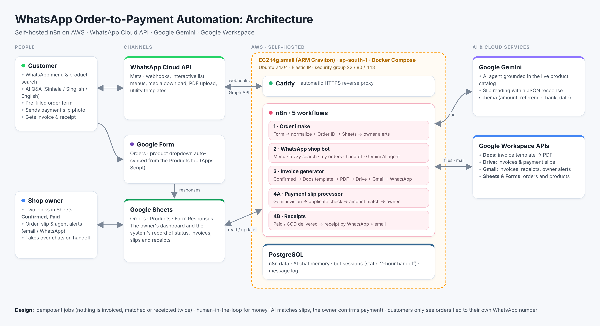

# WhatsApp Order-to-Payment Automation

An end-to-end automation for small shops that sell over WhatsApp: product search, an AI assistant, orders, PDF invoices, AI payment-slip verification and receipts. Built with self-hosted **n8n** on **AWS EC2**, the **WhatsApp Cloud API**, **Google Gemini** and **Google Workspace**.

> 🎬 **Demo video:** https://lnkd.in/p/g5dCuXkB
>
> All data in the demo is sample data. "Demo Bank" and the bank slips in `sample-data/` are fictional.



## What it does

| Step | Who | What happens |
| --- | --- | --- |
| 1 | Customer | Sends `hi` on WhatsApp and gets an interactive list menu |
| 2 | Customer | Searches products with typo tolerance (`moues` → Mouse), sees price, warranty and stock |
| 3 | Customer | Asks anything in Sinhala, English or Singlish; a Gemini agent answers from the live product catalog only |
| 4 | Customer | Gets a Google Form link with name and phone pre-filled, and places the order |
| 5 | System | Saves the order to Google Sheets with an Order ID and alerts the owner |
| 6 | Owner | Sets **Status = Confirmed** → a PDF invoice goes out by email and WhatsApp |
| 7 | Customer | Sends a photo of the bank slip → AI reads it, checks for duplicates, matches the amount to the order, alerts the owner |
| 8 | Owner | Checks the bank and sets **Payment Status = Paid** → receipt by WhatsApp and email (cash-on-delivery orders get one when marked Delivered) |
| 9 | Customer | Checks order status any time, or asks for a human; the bot stays quiet for 2 hours while the owner chats |

## Workflows

Five n8n workflows work together:

| Workflow | Trigger | Purpose |
| --- | --- | --- |
| 1 · Order intake | New Google Form response | Normalize the order, create an Order ID, save it, alert the owner |
| 2 · WhatsApp shop bot | WhatsApp webhook | Menu, product search, order lookup, human handoff, Gemini AI agent with persistent chat memory |
| 3 · Invoice generator | Schedule | Confirmed orders → Google Docs template → PDF → Drive, Gmail, WhatsApp |
| 4A · Payment slip processor | Called by the bot | Media download → Gemini vision (JSON schema) → duplicate check → amount match → owner alert |
| 4B · Receipts | Schedule | Paid and cash-on-delivery orders → receipt by WhatsApp and email |

The workflow files are kept in a private repository. **They're available on request**: see [Contact](#contact).

## Tech stack

- **n8n** (self-hosted) with **PostgreSQL** and **Caddy** (automatic HTTPS), via Docker Compose
- **AWS EC2** t4g.small (ARM Graviton), Ubuntu 24.04, Elastic IP, security group 22 / 80 / 443
- **WhatsApp Cloud API**: webhooks, interactive lists, media, document templates
- **Google Gemini**: AI agent and slip reading with structured JSON output
- **Google Sheets, Forms, Docs, Drive, Gmail** + **Apps Script** (form dropdown synced from the product list)

## Design decisions

- **Idempotent jobs.** Invoices, slips and receipts are keyed on Order ID and slip reference, so a retry never sends twice.
- **Human in the loop for money.** The AI reads and matches slips; only the owner can mark an order as Paid.
- **Privacy.** Customers can only see orders tied to their own WhatsApp number.
- **Single source of truth.** Prices live in one Products sheet: the bot, the AI, the order form and invoices all read from it.

## Infrastructure

The `infra/` folder holds the self-hosting setup:

| File | Purpose |
| --- | --- |
| `docker-compose.yml` | n8n + PostgreSQL + Caddy, no public database or n8n port |
| `Caddyfile` | Reverse proxy with automatic Let's Encrypt certificates |
| `.env.example` | Domain, database password, n8n encryption key (copy to `.env`, never commit it) |
| `backup.sh` | Daily PostgreSQL dump with 14-day retention (cron) |

```bash
mkdir -p ~/n8n && cd ~/n8n
cp /path/to/repo/infra/{docker-compose.yml,Caddyfile,.env.example,backup.sh} .
cp .env.example .env        # set N8N_DOMAIN, POSTGRES_PASSWORD, N8N_ENCRYPTION_KEY
docker compose up -d
```

Point a DNS A record (or a DuckDNS subdomain) at the server first; Caddy then gets the certificate on its own.

## Roadmap

- Extra slip checks: receiver account, slip date, transaction status, confidence threshold
- Error-alert workflow and off-server backups to S3
- Workflows versioned in Git with a CI check on export

## Contact

Interested in an automation like this for your business, or in the workflow files?

- LinkedIn: [rashmika-lakshan-97247a369](https://www.linkedin.com/in/rashmika-lakshan-97247a369)
- GitHub: [rashmika1230](https://github.com/rashmika1230)
- Website: [rashmika1230.github.io/rashmika](https://rashmika1230.github.io/rashmika)

---

© 2026 Rashmika. All rights reserved. This repository is shared for viewing and evaluation only; no license is granted to copy, modify or redistribute its contents.
